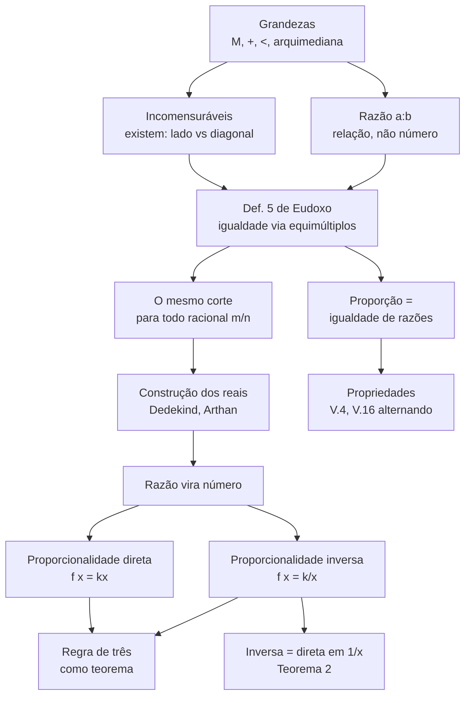
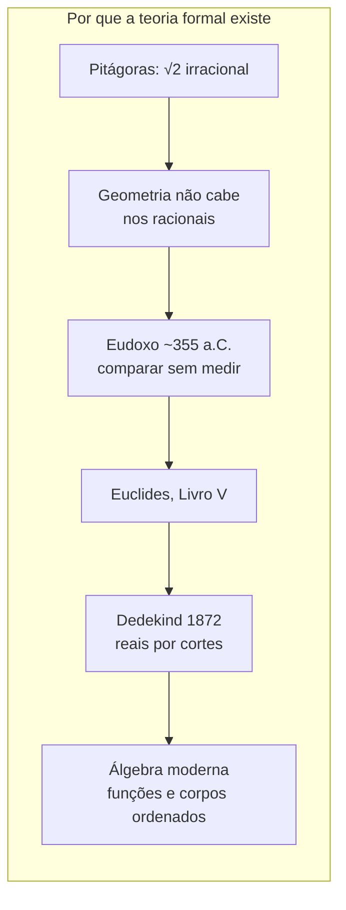

# Razão, proporção e proporcionalidade inversa — tratamento formal

> Esta versão substitui a didática anterior ("material para um adolescente de 14 anos"). O objetivo deixou de ser *operar* a regra de três e passou a ser *entender* por que ela vale. O texto didático original continua recuperável no histórico do git.

## 0. O que muda numa versão formal

A versão didática ensina o procedimento: "multiplique em cruz", "inverta a coluna". Procedimento assim funciona e é útil, mas esconde duas perguntas:

1. **O que é** uma razão, se ela não é um número (e por que, antigamente, não *podia* ser um número)?
2. **Quando** é legítimo multiplicar em cruz? (a resposta tem condições — e as condições falham em casos que a escola não menciona)

A resposta das duas está no **Livro V dos Elementos**, a teoria das proporções atribuída a **Eudoxo de Cnido** (~408–355 a.C.). Ela foi construída justamente para lidar com grandezas **incomensuráveis** (como o lado e a diagonal do quadrado), que a aritmética grega não conseguia tratar como números.

---

## 1. Grandezas (magnitudes)

Uma **grandeza** é uma classe de quantidades comparáveis e somáveis entre si: comprimentos com comprimentos, áreas com áreas, tempos com tempos. Formalmente é uma estrutura `(M, +, <)` — um semigrupo comutativo ordenado — com a propriedade arquimediana.

Euclides fixa isso em quatro definições (Livro V, anexo, pp. 129–130):

> **Def. 1.** *A magnitude is a part of a(nother) magnitude, the lesser of the greater, when it measures the greater.*
> **Def. 2.** *And the greater (magnitude is) a multiple of the lesser when it is measured by the lesser.*
> **Def. 4.** *(Those) magnitudes are said to have a ratio with respect to one another which, being multiplied, are capable of exceeding one another.*

A Def. 4 é a **condição arquimediana**: para haver razão entre `a` e `b`, nenhum dos dois pode ser "infinitamente pequeno" em relação ao outro. É por isso que "razão entre a altura de uma pessoa e a massa da Terra" não tem sentido no vocabulário de Euclides — falta a capacidade de um exceder o outro por multiplicação.

---

## 2. Razão não é número

> **Def. 3.** *A ratio is a certain type of condition with respect to size of two magnitudes of the same kind.*

Uma razão `a : b` é uma **relação de comparação**, não um objeto aritmético. Isso não é preciosismo: é uma necessidade histórica. Se `a : b` fosse o número `a/b`, então a razão entre o lado e a diagonal do quadrado seria `1/√2` — e `√2` simplesmente não existia no sistema numérico grego (só números racionais).

A saída de Eudoxo foi definir **quando duas razões são iguais** sem nunca nomear o número que elas seriam. É a genialidade do Livro V: comparar sem medir.

---

## 3. Igualdade de razões: a definição de Eudoxo

> **Def. 5.** *Magnitudes are said to be in the same ratio, the first to the second, and the third to the fourth, when equal multiples of the first and the third either both exceed, are both equal to, or are both less than, equal multiples of the second and the fourth, respectively, being taken in corresponding order, according to any kind of multiplication whatever.*

Em notação de hoje, `a : b = c : d` significa:

```
para todos m, n ∈ ℕ*:
    m·a >  n·b   ⟺   m·c >  n·d
    m·a =  n·b   ⟺   m·c =  n·d
    m·a <  n·b   ⟺   m·c <  n·d
```

**Leitura moderna.** Dividindo por `n·b` e `n·d`, a condição diz que `a/b` e `c/d` produzem **o mesmo corte** no conjunto dos racionais: para toda fração `m/n`, os dois lados estão do mesmo lado dela. Isso é exatamente a construção dos reais por **cortes de Dedekind** (1872), só que 22 séculos antes e sem o conceito de número real. A razão `a : b` é o corte; o número real é o que a matemática do século XIX passou a chamar de razão.

> **Def. 6.** *And let magnitudes having the same ratio be called proportional.*

Proporção é, portanto, apenas isso: **igualdade de razões**. Nada mais.

Consequência imediata: a relação "tem a mesma razão que" é uma **relação de equivalência** — reflexiva, simétrica e transitiva (a transitividade é a Proposição V.11). Proporção é uma relação de equivalência sobre pares de grandezas.

---

## 4. As propriedades, e a condição que a escola não conta

> **Proposição V.4.** *If a first (magnitude) has the same ratio to a second that a third (has) to a fourth then equimultiples...* — igualdade de razões é preservada por multiplicação.
> **Proposição V.16.** *If four magnitudes are proportional then they will also be proportional alternately.* — `a : b = c : d ⟹ a : c = b : d` (**alternando**).

A **propriedade fundamental das proporções** que se aprende na escola é:

```
a/b = c/d   ⟺   a·d = b·c
```

Ela é **verdadeira para números** (em corpo ordenado) — e a prova é curta: multiplicando `a/b = c/d` por `b·d ≠ 0` obtém-se `a·d = b·c`; reciprocamente, `a·d = b·c` com `b, d ≠ 0` dá `a/b = c/d`.

Mas note a hipótese escondida: o produto `a·b` **precisa existir**. Euclides **nunca** multiplica razões em geral — ele não pode, porque não existe produto de grandeza por grandeza de outra espécie (o que seria "comprimento × tempo"?). A multiplicação em cruz funciona no Livro V porque Euclides apenas multiplica por **números naturais** (equimúltiplos, Def. 5), nunca grandeza por grandeza.

Onde a escola vive: no terreno dos números, onde tudo é multiplicável. É um caso particular, muito confortável, do que Eudoxo teve de fazer sem ele.

---

## 5. Proporcionalidade como função

Aqui a teoria antiga encontra a álgebra moderna. Sejam `X, Y ⊆ ℝ₊*` e `f : X → Y`.

**Definição (proporcionalidade direta).**
```
f é diretamente proporcional  ⟺  ∃ k > 0 : f(x) = k·x  para todo x ∈ X
```

**Definição (proporcionalidade inversa).**
```
f é inversamente proporcional  ⟺  ∃ k > 0 : f(x) = k/x  para todo x ∈ X
```

**Teorema 1 (caracterização pelo produto constante).**
`f` é inversamente proporcional **se e só se** `x · f(x)` é constante.

*Prova.* (⟹) `x · (k/x) = k`. (⟸) Se `x·f(x) = k`, então `f(x) = k/x`. ∎

**Teorema 2 (inversa = direta na recíproca).**
`f` é inversamente proporcional a `x` **se e só se** `f` é diretamente proporcional a `1/x`.

*Prova.* `f(x) = k/x = k·(1/x)`. A recíproca é a mesma igualdade lida ao contrário. ∎

Este teorema é o coração formal da "regra de três inversa": inverter a coluna não é um truque mnemônico, é a mudança de variável `x ↦ 1/x`.

**Teorema 3 (a regra de três como teorema).**
Se `f(x) = k·x` e `f(x₁) = y₁`, então para todo `x₂`:
```
f(x₂) = y₁ · x₂ / x₁
```
*Prova.* `k = y₁ / x₁` (bem definido, `x₁ ≠ 0`), logo `f(x₂) = k·x₂ = y₁·x₂/x₁`. ∎

Analogamente, se `x·f(x) = k` e `f(x₁) = y₁`:
```
f(x₂) = y₁ · x₁ / x₂
```
que é a fórmula da regra de três inversa — quando a coluna é invertida, o resultado é o mesmo de aplicar o Teorema 3 à função `g(x) = f(1/x)`, diretamente proporcional em `1/x` pelo Teorema 2.

**Corolário (razão das imagens).** Se `f` é inversamente proporcional, então `f(x₁)/f(x₂) = x₂/x₁`: a razão entre os valores é a **razão inversa** (recíproca) entre os pontos. É a formalização do "quanto mais... menos...".

---

## 6. Duas coisas que o nome parecido confunde

| Expressão | O que é | Exemplo |
|---|---|---|
| **razão inversa** de `a : b` | a razão `b : a` (trocar a ordem) | inversa de `3:4` é `4:3` |
| **grandezas inversamente proporcionais** | `∃k : x·y = k` (produto constante) | velocidade e tempo com distância fixa |

São conceitos **diferentes**, e a semelhança de nome é fonte garantida de confusão. A confusão desaparece quando se escreve a segunda em função: `y = k/x`, cujo gráfico é uma **hipérbole** com as coordenadas como assíntotas — enquanto "razão inversa" nem é uma função, é só uma reordenação de um par ordenado.

---

## 7. Mapas mentais





---

## 8. Exemplo verificável em código

A Def. 5 é testável: comparação por equimúltiplos. O código abaixo testa a definição para `1 : √2` e `√2 : 2` (razões de grandezas incomensuráveis) e para um par que **não** está em proporção.

```python
from fractions import Fraction

def mesma_razao(a, b, c, d, N=400):
    """Testa a Definicao 5 usando os multiplicadores m/n em 1..N."""
    for m in range(1, N + 1):
        for n in range(1, N + 1):
            esq = (m * a) - (n * b)
            dir_ = (m * c) - (n * d)
            # Def. 5: os dois lados tem de cair no mesmo lado de m/n
            if (esq > 0) != (dir_ > 0) or (esq == 0) != (dir_ == 0):
                return False, (m, n)
    return True, None

print(mesma_razao(1.0, 2 ** 0.5, 2 ** 0.5, 2.0))   # (True, None)
print(mesma_razao(2.0, 4.0, 3.0, 6.0))              # (True, None)
print(mesma_razao(2.0, 4.0, 3.0, 7.0))              # (False, (2, 1))
```

Saída verificada: `1 : √2 = √2 : 2` e `2 : 4 = 3 : 6` passam; `2 : 4 ≠ 3 : 7` é refutada em `m = 2, n = 1` — à esquerda `2·2 = 4` empata com `1·4`, à direita `2·3 = 6` fica abaixo de `1·7`, ou seja o **mesmo** `m/n` cai em lados diferentes.

O teste **não prova** a igualdade (nenhum teste finito prova uma afirmação sobre *todos* os `m, n`) — ele apenas a refuta ou a corrobora. Daí a necessidade de prova dedutiva, e daí existir a Def. 5 em vez de um algoritmo.

---

## 9. Exercícios formais (com gabarito)

1. **Prove:** se `a/b = c/d` com `b, d ≠ 0` em `ℝ`, então `a/c = b/d` (desde que `c ≠ 0`).
   *Gab.* De `a·d = b·c`, divida ambos os lados por `c·d` (que é `≠ 0`).
2. **Prove:** a relação "tem a mesma razão que" é transitiva.
   *Gab.* Use a Def. 5: se `a:b = c:d` e `c:d = e:f`, a composição das equivalências de desigualdades dá `a:b = e:f`. (No caso numérico é imediato por `a/b = c/d = e/f`.)
3. **Mostre** que "diretamente proporcional" é preservada por composição, mas "inversamente proporcional" **não** é: a composição de duas funções inversamente proporcionais é diretamente proporcional.
   *Gab.* `f(x) = k/x` e `g(y) = j/y` dão `g(f(x)) = j·x/k` — direta.
4. **Contra-exemplo:** dê `x, y > 0` em que `x` e `y` são inversamente proporcionais num domínio e **deixam** de ser ao acrescentar um ponto.
   *Gab.* `xy = k` sobre `{1, 2}` com `k = 2` vale; acrescentando `x = 3`, só vale se `y = 2/3`.

---

## 10. Fontes anexadas

**1. Euclides — Elementos, Livro V (teoria das proporções de Eudoxo).** Texto bilíngue grego/inglês, tradução e edição de Richard Fitzpatrick (domínio público). Recorte das 26 páginas do Livro V, extraído por mim do livro completo.

![[euclides-elementos-livro-V-proporcoes.pdf]]

**2. R. D. Arthan — *The Eudoxus Real Numbers* (arXiv:math/0405454, 2004).** Constrói os números reais diretamente a partir dos inteiros, inspirado na teoria das proporções de Eudoxo — a ponte formal entre a Def. 5 e a álgebra contemporânea (ver §3).

![[arthan-2004-numeros-reais-de-eudoxo.pdf]]

**3. Christian Antić — *Proportoids* (arXiv:2210.01751).** Formalização moderna da proporção como **relação quaternária** `a : b :: c : d` e axiomatização do que o autor chama de *proportoid*: o que sobra da ideia de proporção quando se abandona o contexto numérico original. Leitura de §5 e §6 daqui.

![[antic-proporcoes-analogicas-proportoids.pdf]]

Fontes citadas sem cópia local (verificar disponibilidade antes de usar): Conor Mayo-Wilson, *Eudoxus' Theory of Proportion, Greek Number Theory, and Incommensurability* (notas de curso, Univ. of Washington) — slides úteis para a leitura epistemológica da Def. 5.

---

## 11. Próximos passos

- [ ] Provar a Proposição V.16 (alternando) a partir da Def. 5 — exercício central para "sentir" a definição
- [ ] Ler o Arthan (anexo 2) e escrever um permanente sobre "reais pelos cortes de razões"
- [ ] Ler o Antić (anexo 3) e decidir se "proporção analógica" merece nota própria
- [ ] Retomar a versão didática para o adolescente, agora derivada desta (o procedimento passa a ter justificativa)
- [ ] Reescrever a regra de três como caso particular do Teorema 3, com as hipóteses explícitas (`b, d ≠ 0`)

*Nota original criada em 12/10/2026 como material didático; reescrita em 16/10/2026 em versão formal.*
