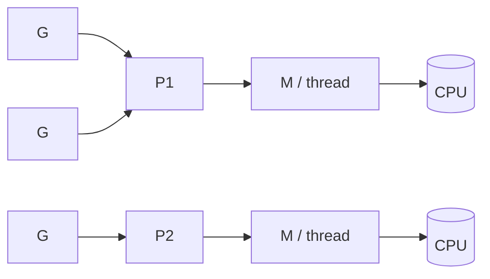
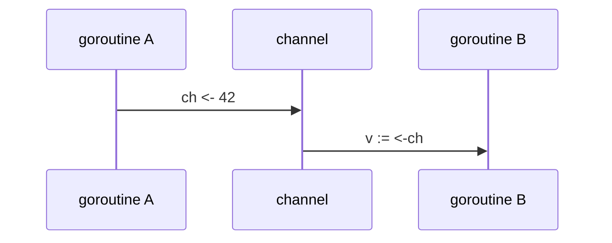

# Goroutines em Go

**Ideia central:** goroutine é uma função executada de forma concorrente, gerenciada pelo *runtime* do Go (não pelo SO). É leve (~2 KB de stack inicial, que cresce sob demanda), então é viável criar milhares delas.

```go
go func() {
    fmt.Println("rodando concorrentemente")
}()
```

## Como o scheduler funciona (G-M-P)

![[goroutines-gmp.svg]]

- **G**: goroutine
- **M**: thread do SO
- **P**: processador lógico (quantidade = `GOMAXPROCS`); cada P tem uma fila local
- Um P ocioso pode roubar trabalho de outro (*work stealing*).



## Comunicação com channels

![[goroutines-channel.svg]]

```go
ch := make(chan int)
go func() { ch <- 42 }()
v := <-ch
```



## Pontos de atenção
- `main` terminando encerra todas as goroutines; use `sync.WaitGroup` para esperar.
- Evite *data races*: use channels ou `sync.Mutex` (teste com `go run -race`).
- Goroutine sem saída = *goroutine leak*; use `context` para cancelamento.

## Relacionadas
- [[MOC Go]]
- [[Concorrência vs Paralelismo]]
